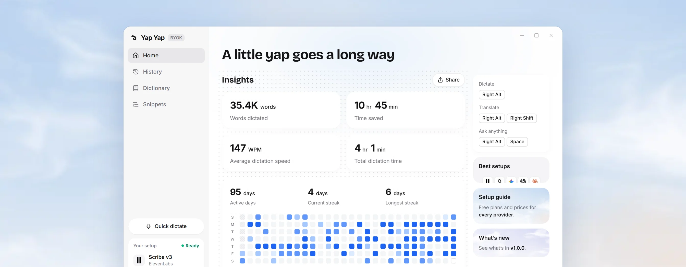

# Yap Yap

Tap a shortcut in your notes app, say “um, can we move the launch to Friday?”, and Yap Yap types the cleaned-up sentence at your cursor. Use the same floating recorder to translate a message or ask a question. You choose who transcribes your audio and who edits the text.

**Yap Yap has been tested on Windows x64.** The macOS and Linux builds are experimental. They pass automated checks, but recording, global shortcuts, and pasting have yet to be tested end to end on those platforms.

**[Try the interactive demo](https://yapyap-app.vercel.app/) · [Run from source](#run-from-source) · [Desktop releases](https://github.com/Mohamed-Eltelb/yap-yap/releases)**

<p align="center">
  
</p>

## Your first dictation

1. Launch the desktop app and allow microphone access. Under **Settings → API Keys**, choose **Groq**, enter your own key, and select **Verify & add**. Groq can handle both transcription and text cleanup with one key. [Provider setup guide](https://yapyap-app.vercel.app/providers.html#groq)
2. Click inside a blank note. Tap and release the **Dictate** shortcut shown on Home, speak a sentence, then tap the shortcut again to finish.
3. With auto-paste enabled, the result appears at your cursor. Open **History** to replay, edit, or retry it with another provider.

| Mode | Default shortcut | Try saying |
| --- | --- | --- |
| Dictate | Right Alt | “Remind me to send Noor the slides on Friday.” |
| Translate | Right Alt + Right Shift | “The train arrives at half past six.” Choose a target language to get the translation. |
| Ask anything | Right Alt + Space | “What’s a shorter way to say ‘at your earliest convenience’?” |

Change shortcuts in Settings. Add names to your dictionary to help transcription, or create a snippet that expands a spoken phrase into text you use often.



## Updates

The desktop app checks GitHub for a newer public release at launch. Choose **Download** to save the installer and verify its SHA-256 checksum. Yap Yap reveals the file in Downloads so you can run it when ready. You can also check from Settings.

## Choose your providers

| Task | Built-in connections |
| --- | --- |
| Speech to text | Groq, OpenAI, Google Gemini, Deepgram, ElevenLabs |
| Cleanup, translation, and answers | Groq, OpenAI, Google Gemini, Anthropic Claude |

The **Custom / OpenAI-Compatible** connection can use a server you run yourself. Use an endpoint that supports the operation you select, such as audio transcription for dictation or chat completions for cleanup. Cloud providers bill usage to your own account.

## Run from source

Use Git and Node.js **24.15 or newer on the 24.x line** for the setup below. The renderer preview and automated tests run without provider keys.

```sh
git clone https://github.com/Mohamed-Eltelb/yap-yap.git
cd yap-yap
npm ci
npm run dev
```

| Platform | Desktop setup |
| --- | --- |
| Windows x64 | The source checkout includes the native shortcut DLL. To rebuild it, install Visual Studio C++ Build Tools with the x64 toolchain and Windows SDK, then run `npm run build:keyhook`. |
| macOS (experimental) | Allow microphone access. Global shortcuts and pasting can require Accessibility, Input Monitoring, and Automation permissions for the app you launch. |
| Linux (experimental) | Use an X11 session with `xdotool` installed for auto-paste. Global shortcuts and pasting depend on the display session. |

Use `npm run dev:web` to explore the interface in a browser at `http://localhost:5173`. Global shortcuts, the floating desktop recorder, and cross-app paste run in Electron.

## Where your data goes

Your configured speech provider receives audio for transcription. Cleanup, translation, and Ask anything can send dictated content and enabled personalization context to your AI provider. Models with web search can use their provider’s search service when answering a question.

History, retained recordings, and settings live in your local app profile. **Provider keys are stored locally without application-level encryption.** Treat that profile and its backups as sensitive. History retention, context awareness, and learning from edits can be adjusted in Settings.

## Contribute

The app uses React and TypeScript for the interface, Electron for desktop integration, and a small C++ helper for Windows shortcuts. The contributor guide covers tests, packaging, and where to make changes. [Contributing](CONTRIBUTING.md) · [Report a security issue privately](SECURITY.md)

Yap Yap is released under the MIT license. Fonts, icons, and bundled dependencies carry their own notices. [License](LICENSE) · [Third-party notices](THIRD_PARTY_NOTICES.md)
